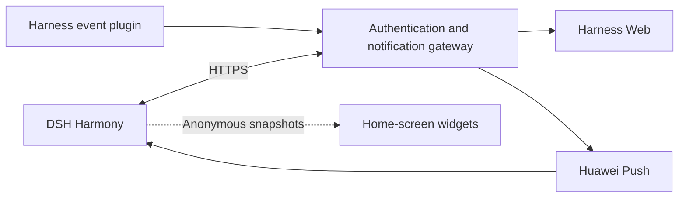

<p align="center">
  
</p>

# DSH Harmony

**Your DeepSeek Harness workspace, on HarmonyOS.**

[简体中文](README.md) · English

DSH Harmony is a HarmonyOS companion for [DeepSeek Harness](https://github.com/deepseek-ai/deepseek-harness). Connect to your self-hosted workspace from a phone or tablet, continue conversations, follow tool execution and streaming output, and keep track of progress through system notifications and home-screen widgets.

The app preserves the original Harness Web interface and adds Passkey authentication, Huawei Push, native materials, and desktop shortcuts around it.

[Getting started](#getting-started) · [Deployment guide](docs/DEPLOYMENT.md) · [HarmonyOS 7 and widgets](docs/HARMONY7.md) · [License](LICENSE)

## Features

### Connect to your workspace

- Use the original Harness conversations, tools, files, and streaming output.
- Native connection setup, back navigation, refresh, system file selection, and keyboard avoidance.
- Phone and tablet layouts, with app settings and native chrome following the workspace's light or dark theme.

### Sign in with a Passkey

- Register and authenticate with a system Passkey, verified by the gateway using WebAuthn.
- Pair your first credential with an administrator-provided setup secret, then use your Passkey for subsequent sign-ins.
- Explicitly enable unauthenticated access for a trusted, isolated network. Authentication policy remains under server control.

### Receive task notifications

- Huawei Push notifications for completion, failures, and approval requests.
- A persistent server-side delivery queue with deduplication, retries, and expiration.
- Generic lock-screen messages and notification registration revocation on sign-out.

Notification display depends on device permissions, connectivity, and Huawei Push delivery policies.

### Feel at home on HarmonyOS

- System materials, touch lighting, and interaction feedback for native navigation controls on HarmonyOS 7.
- Reduced-transparency and reduced-motion preferences, with fallbacks for power saving and unsupported capabilities.
- System safe areas and font scaling, with native chrome kept clear of Web controls.

The available material effects depend on the OS version, device capabilities, and system settings.

### Open your workspace from the home screen

| Widget | Purpose |
| --- | --- |
| **Workspace shortcut · 2×2** | Open Harness directly, or start connection setup when disconnected. |
| **Task overview · 2×4** | View anonymous counts for running, approval-waiting, recently completed, and recently failed sessions; open the app to synchronize. |

Task counts are hidden by default and can be enabled under **Settings → Desktop widgets**. Widgets store timestamped, anonymous snapshots without server addresses, project names, or conversation content. Counts reflect the latest session states observed by the plugin, rather than live connectivity or cumulative task totals.

## How it works



Harness runs on your server or computer. The gateway handles Passkey authentication, proxied access, and notification delivery. The native app displays the workspace and integrates with system services. Widgets use local snapshots synchronized by the app and do not hold login credentials.

DSH Harmony currently supports **one user and one Harness instance per deployment**. Paired devices share that workspace.

## Getting started

### 1. Prepare your environment

| Component | Requirement |
| --- | --- |
| Harness | A working DeepSeek Harness Web service |
| Gateway | Node.js **24.9+**, preferably 24.x, with access to Harness |
| Network | An HTTPS domain with a valid certificate, reachable from your device; a reverse proxy supporting streaming and WebSockets |
| Native build | DevEco Studio, the **API 26.0.0 SDK**, and a matching HarmonyOS signing configuration |
| System notifications | A Huawei application project with Push Kit enabled and a server-side service account; optional if notifications are not needed |

### 2. Deploy the gateway and plugin

Clone the repository and install the gateway dependencies:

```bash
git clone https://github.com/stlin256/dsh-harmony.git
cd dsh-harmony/gateway
npm ci
cp .env.example .env
```

Follow the [deployment guide](docs/DEPLOYMENT.md) to configure your HTTPS origin, Harness upstream connection, pairing secret, and event secret. Then start the gateway:

```bash
npm start
```

Install the included event plugin in Harness and configure the same event secret. Configure a Huawei Push service account if you want system notifications.

### 3. Build and connect the app

1. Open `harmony/` in DevEco Studio.
2. Copy `build-profile.example.json5` to `build-profile.json5`, configure signing, and build and install the app.
3. Enter the gateway's HTTPS address and pair a Passkey, or use the authentication mode permitted by your server.
4. Enable notifications if desired, and long-press the app's home-screen icon to add a service widget.

See the [deployment guide](docs/DEPLOYMENT.md) for signing permissions, reverse-proxy configuration, Passkey recovery, and Push setup.

## Compatibility and status

**Development preview.** HarmonyOS compilation and on-device acceptance are still pending. Native materials, Passkeys, and service-widget compatibility require device validation. The project currently provides a source-build workflow.

The native project targets API 26.0.0 with a minimum compatibility configuration of API 23. New material APIs have runtime version guards, while older versions retain the basic interface. See the [validation checklist](docs/VALIDATION.md) for device testing.

Widgets synchronize while the app is in the foreground and retain timestamped snapshots after it exits. This version does not provide live background widget updates. Unauthenticated mode is intended only for a trusted, isolated network and should not be exposed directly to the public internet.

## Documentation and source layout

The detailed guides below are currently in Chinese.

| Resource | Contents |
| --- | --- |
| [Deployment](docs/DEPLOYMENT.md) | Gateway, plugin, HTTPS, signing, Passkeys, and Push setup |
| [HarmonyOS 7 and widgets](docs/HARMONY7.md) | Native capabilities, widget privacy, state aggregation, and device acceptance |
| [Interface design](docs/DESIGN.md) | Harness styling, themes, and motion conventions |
| [Validation](docs/VALIDATION.md) | Automated coverage and device testing checklist |
| [`harmony/`](harmony/) | ArkTS native application and service widgets |
| [`gateway/`](gateway/) | Authentication gateway, settings interface, and notification service |
| [`plugins/pocket-notify/`](plugins/pocket-notify/) | Harness event plugin |

## Contributing

Issues and improvements are welcome. For compatibility reports, include the app, OS, and SDK versions, reproduction steps, and sanitized diagnostics.

Run the server and native service-logic tests with:

```bash
cd gateway
npm ci
npm test
```

Native service-logic tests use mocked system interfaces and do not replace DevEco builds or on-device testing. Before committing, run `node scripts/check-publication.mjs` from the repository root to check reachable history and staged content. Keep deployment addresses, access tokens, signing materials, and service accounts out of the repository.

## Acknowledgments and license

- [DeepSeek Harness](https://github.com/deepseek-ai/deepseek-harness) provides the workspace and plugin ecosystem.
- [claudecodeui](https://github.com/stlin256/claudecodeui) provides the reference foundation for the native Web shell and HarmonyOS integration.

Licensed under [GNU AGPL v3](LICENSE). See [NOTICE](NOTICE) for source attribution.
