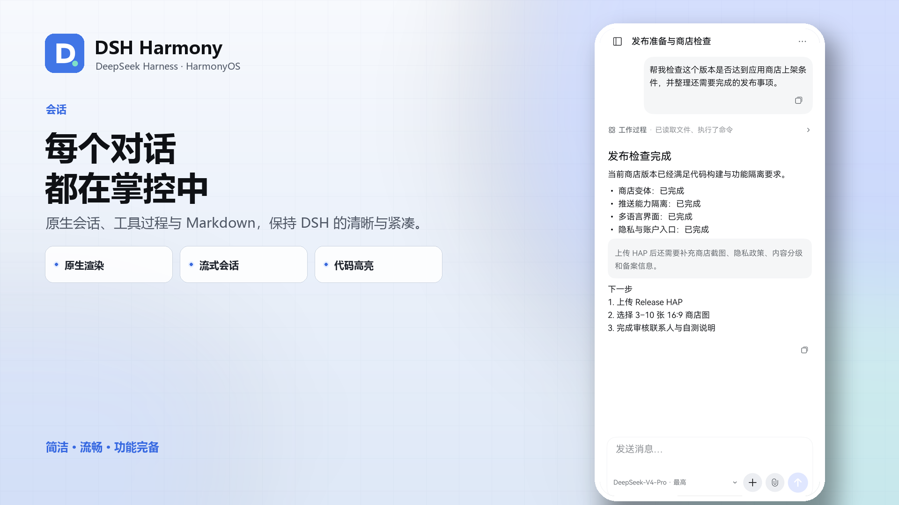
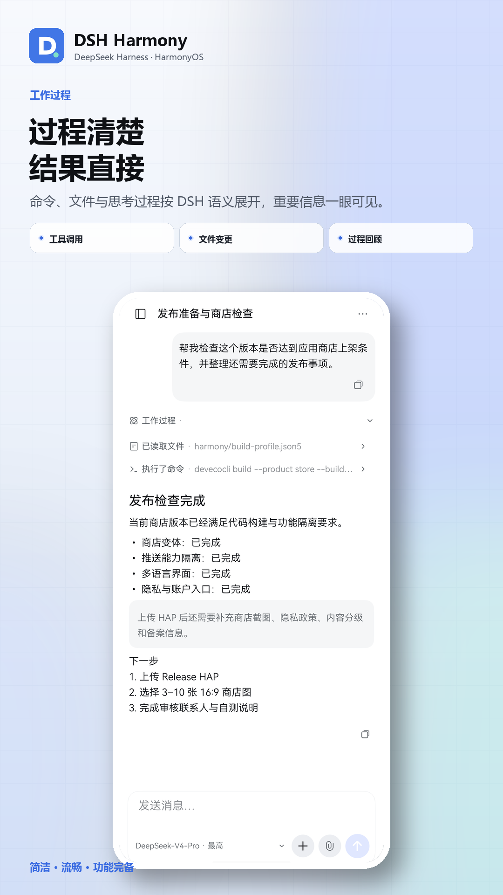
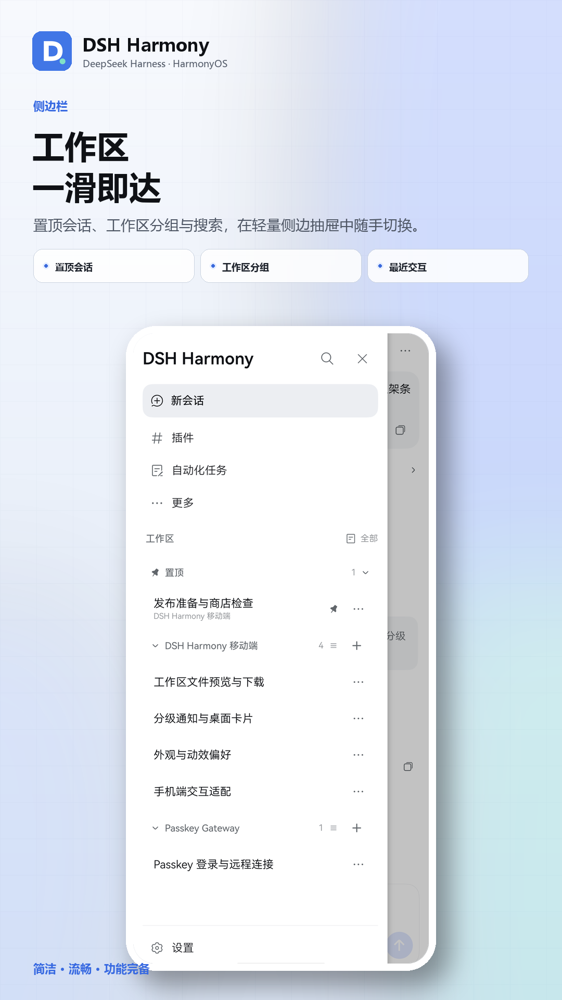
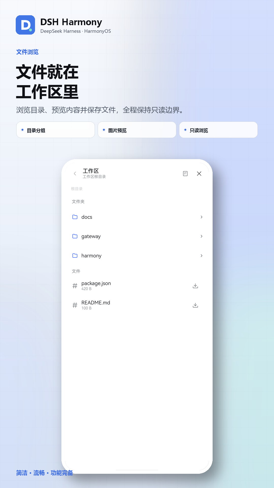
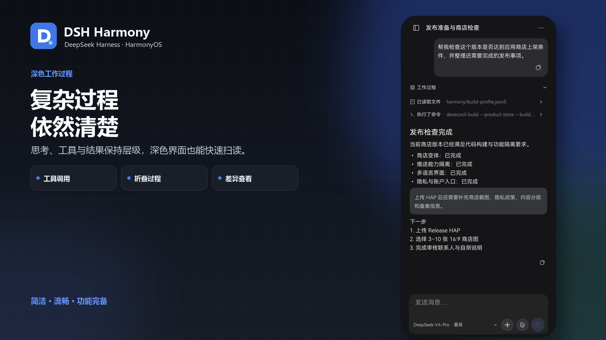
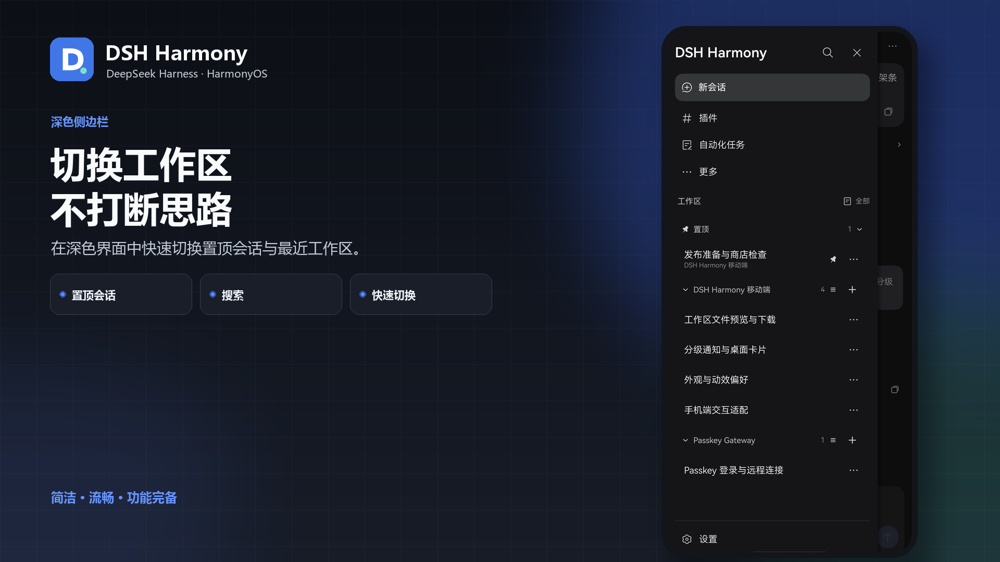

<p align="center">
  
</p>

<h1 align="center">DSH Harmony</h1>

<p align="center">
  <strong>DeepSeek Harness, made for HarmonyOS</strong><br>
  The original workflow with a native touch.
</p>

<p align="center">
  <a href="https://github.com/deepseek-ai/deepseek-harness">
    
  </a>
  <a href="https://github.com/deepseek-ai/deepseek-harness"><strong>DeepSeek Harness</strong></a>
  &nbsp;·&nbsp;
  
  
  
</p>

<p align="center">
  <strong>English</strong> · <a href="README.md">简体中文</a>
</p>

---

## Harness, designed for a phone

DSH Harmony brings DeepSeek Harness workspaces, sessions, tool calls and live output to HarmonyOS. Keep every capability of the original web workspace, or switch to a native surface redesigned for touch, keyboards, safe areas and system Back.

The goal goes beyond making Harness fit. From cold start to long-history scrolling, from a tool call to a background notification, DSH Harmony is built around less waiting, clearer state and more natural interaction.

## The workflow at a glance

<p align="center">
  
</p>

<table>
  <tr>
    <td align="center" width="33%">
      <br>
      <strong>Clear process, direct results</strong><br>
      <sub>Reasoning, commands and file changes stay compact and expand in context.</sub>
    </td>
    <td align="center" width="33%">
      <br>
      <strong>Workspaces in order</strong><br>
      <sub>Pinned sessions, recents, search and workspace controls stay within reach.</sub>
    </td>
    <td align="center" width="33%">
      <br>
      <strong>Files live in the workspace</strong><br>
      <sub>Browse folders and preview Markdown, code and images in read-only form.</sub>
    </td>
  </tr>
</table>

<p align="center">
  
  
</p>

## Fluid, focused and complete

| **Fluid** | **Focused** |
| --- | --- |
| Cache-first rendering and incremental sync preload nearby history. Stable lists and virtualized rendering keep long conversations light, while transitions follow HarmonyOS motion. | DSH's compact hierarchy and visual language keep tools, reasoning, files and messages distinct without letting chrome compete with content. |
| Press feedback, drawers, navigation, safe areas and system Back are implemented natively, with respect for reduced-motion preferences. | Sessions, models, tools, approvals, questions, images, Markdown, code, file browsing and tiered notifications cover real mobile workflows. |

## Two experiences, one workspace

**Compatibility mode** preserves the original Harness web workspace, plugins and advanced controls. Native settings integrate into its sidebar, so the familiar interface stays one product.

**Native mode** rebuilds high-frequency flows in ArkUI: sessions, live messages, tool steps, approvals, questions, model selection, file previews and an image lightbox all use DSH's visual language. It remembers the last session, workspace, scroll position and disclosure state.

Login stays flexible:

- **Harness native login** is the default and works with LAN or public deployments.
- **Pocket ID / Passkey** is optional for HTTPS environments and uses the system Passkey flow.

## Get started

Send this prompt to DSH. An agent with `plugin_manager` support will install the plugin and verify its version:

```text
Follow https://github.com/stlin256/DSH-Harmony/blob/main/docs/PLUGIN-INSTALL.md to install and enable DSH Harmony. Use dsh-harmony-plugin-0.3.6.tgz from the matching plugin-v0.3.6 release, then verify that @dsh-harmony/plugin is running and report its version.
```

You can also open **Plugins → Add plugin** in DSH and paste the same versioned tarball URL. Then open DSH Harmony, enter the service origin and choose native login or Passkey.

Setup guides:

[Plugin installation](docs/PLUGIN-INSTALL.md) · [Deployment](docs/DEPLOYMENT.md) · [Passkey](docs/OIDC-DEPLOYMENT.md) · [Interface modes](docs/UI-MODES.md)

## Stay close to every task

DSH Harmony can send tiered HarmonyOS notifications when a task completes, fails or waits for approval. Tapping a notification returns to its session, while home-screen service widgets summarize workspaces and task state.

Personal builds can use Push Kit for immediate delivery. The planned AppGallery build will use a store-specific configuration and provide background status monitoring where system policy allows.

## Coming to AppGallery

<p align="left">
  <a href="https://developer.huawei.com/consumer/en/appgallery/">
    
  </a>
  <strong>HarmonyOS AppGallery · In preparation</strong>
</p>

We are preparing an AppGallery release for every HarmonyOS user. It will keep the same fluid interface, complete session experience and DSH-native design while following AppGallery distribution and notification requirements.

## Build it with us

DSH Harmony is open source. Issues, ideas and pull requests are welcome; start with the [validation guide](docs/VALIDATION.md) and the implementation specs in the repository.

[Report an issue](https://github.com/stlin256/DSH-Harmony/issues) · [View source](https://github.com/stlin256/DSH-Harmony) · [Author](https://github.com/stlin256)

<p align="center">
  <sub>Built for HarmonyOS with care. AGPL-3.0.</sub>
</p>
