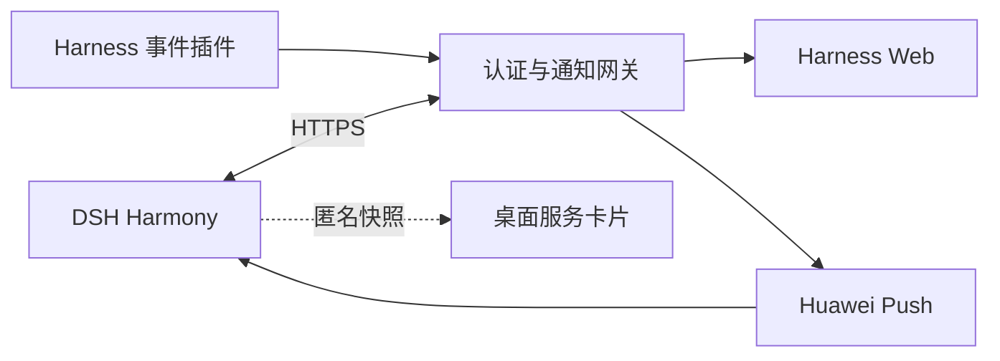

<p align="center">
  
</p>

# DSH Harmony

**把 DeepSeek Harness 工作空间带到 HarmonyOS。**

简体中文 · [English](README.en.md)

DSH Harmony 是面向 HarmonyOS 的 [DeepSeek Harness](https://github.com/deepseek-ai/deepseek-harness) 伴侣应用。通过原生 ArkWeb 访问自托管工作空间，在手机和平板上继续会话、查看工具执行和实时输出，并用系统通知与桌面服务卡片关注任务进展。

应用保留 Harness 原版 Web 界面，在系统层补充 Passkey 登录、Huawei Push、原生材质和桌面入口，让远程工作空间融入 HarmonyOS 的日常使用体验。

[快速开始](#快速开始) · [部署指南](docs/DEPLOYMENT.md) · [HarmonyOS 7 与桌面卡片](docs/HARMONY7.md) · [许可证](LICENSE)

## 主要功能

### 随时连接工作空间

- 直接使用 Harness 原版会话、工具、文件和实时输出，无需维护另一套聊天界面。
- 提供原生连接向导、返回与刷新、系统文件选择和软键盘避让。
- 支持手机和平板布局，应用设置与原生栏跟随工作空间的明暗主题。

### 使用 Passkey 登录

- 通过系统 Passkey 完成注册和登录，网关验证 WebAuthn 凭据。
- 首次配对使用管理员提供的密钥；后续使用已有 Passkey 登录。
- 可为受信任的隔离网络显式启用无验证模式，登录策略由服务端控制。

### 接收任务提醒

- 任务完成、执行失败或需要审批时，通过 Huawei Push 发送系统通知。
- 服务端持久化投递队列，支持去重、失败重试与过期清理。
- 锁屏仅显示通用提示；退出登录会撤销对应的通知注册。

通知展示取决于设备权限、网络及 Huawei Push 的投递策略。

### 贴合 HarmonyOS 的原生体验

- 为 HarmonyOS 7 的原生导航操作接入系统材质、触控光效和交互反馈。
- 支持减少透明效果、减少动态效果，并在省电或不支持相关能力时回退。
- 保留系统安全区，适配字体缩放，避免原生栏遮挡网页操作。

实际材质效果由系统版本、设备能力和系统设置共同决定。

### 从桌面进入任务

| 卡片 | 用途 |
| --- | --- |
| **工作空间入口 · 2×2** | 一键打开 Harness；未连接时进入连接向导。 |
| **任务状态概览 · 2×4** | 查看运行中、待审批、近期完成及近期失败的匿名数量，并打开应用同步状态。 |

卡片默认隐藏任务数量，可在“设置 → 桌面卡片”中开启。桌面只保存带时间的匿名快照，不显示服务器地址、项目名或对话内容。数量按插件观测到的会话最近状态统计，并非实时在线状态或累计任务次数。

## 工作方式



Harness 运行在你自己的服务器或电脑上。网关提供 Passkey 认证、代理访问和通知投递；原生应用负责显示工作空间及调用系统能力。桌面卡片使用应用同步的本地快照，不持有登录凭据。

DSH Harmony 当前采用**单用户、单 Harness 实例**模型，同一部署下的配对设备共享工作空间。

## 快速开始

### 1. 准备运行环境

| 组件 | 要求 |
| --- | --- |
| Harness | 可正常运行的 DeepSeek Harness Web 服务 |
| 网关 | Node.js **24.9+**，建议使用 24.x；可访问 Harness 的运行环境 |
| 网络 | 手机可访问的 HTTPS 域名及有效证书，支持流式响应和 WebSocket 的反向代理 |
| 原生构建 | DevEco Studio、**API 26.0.0 SDK** 及匹配的 HarmonyOS 签名配置 |
| 系统通知 | 启用 Push Kit 的 Huawei 应用项目及服务端服务账号；不使用通知时可省略 |

### 2. 部署网关与插件

获取源码后安装网关依赖：

```bash
git clone https://github.com/stlin256/dsh-harmony.git
cd dsh-harmony/gateway
npm ci
cp .env.example .env
```

按照 [部署指南](docs/DEPLOYMENT.md) 配置 HTTPS 源地址、Harness 上游连接、配对密钥及事件密钥，再启动网关：

```bash
npm start
```

在 Harness 中安装项目提供的通知插件，并配置相同的事件密钥。需要系统通知时，再接入 Huawei Push 服务账号。

### 3. 构建并连接应用

1. 在 DevEco Studio 中打开 `harmony/`。
2. 复制 `build-profile.example.json5` 为 `build-profile.json5`，配置签名并构建安装。
3. 在应用中填写网关的 HTTPS 地址，完成 Passkey 配对或使用服务端允许的登录方式。
4. 按需开启通知，并长按桌面应用图标添加服务卡片。

完整的签名权限、反向代理、Passkey 恢复和 Push 配置见 [部署指南](docs/DEPLOYMENT.md)。

## 兼容性与项目状态

**开发预览阶段。** 原生工程尚未完成 HarmonyOS 编译与真机验收；原生材质、Passkey 和服务卡片的设备兼容性仍需验证。项目目前提供源码构建方式。

工程目标 SDK 为 API 26.0.0，最低兼容配置为 API 23。新材质接口带版本保护，低版本保留基础界面。设备验证项目见 [验收清单](docs/VALIDATION.md)。

桌面卡片在应用前台同步，应用退出后保留带时间的快照；本版本不提供后台实时桌面状态。无验证模式仅适合受信任的隔离网络，不应直接暴露到公网。

## 文档与项目结构

| 入口 | 内容 |
| --- | --- |
| [部署指南](docs/DEPLOYMENT.md) | 网关、插件、HTTPS、签名、Passkey 与 Push 配置 |
| [HarmonyOS 7 与卡片](docs/HARMONY7.md) | 原生能力、卡片隐私、状态统计及设备验收 |
| [界面设计](docs/DESIGN.md) | Harness 风格、主题和动效约定 |
| [验证说明](docs/VALIDATION.md) | 自动化验证范围与设备测试清单 |
| [`harmony/`](harmony/) | ArkTS 原生应用与服务卡片 |
| [`gateway/`](gateway/) | 认证网关、设置页面与通知服务 |
| [`plugins/pocket-notify/`](plugins/pocket-notify/) | Harness 事件插件 |

## 参与贡献

欢迎提交问题与改进。反馈兼容性问题时，请提供应用版本、系统与 SDK 版本、复现步骤以及脱敏后的诊断信息。

服务端与原生服务逻辑测试：

```bash
cd gateway
npm ci
npm test
```

原生服务逻辑测试使用系统接口模拟，不能替代 DevEco 构建和真机测试。提交前可在仓库根目录运行 `node scripts/check-publication.mjs` 检查仓库历史与暂存内容；请勿提交部署地址、访问令牌、签名材料或服务账号。

## 致谢与许可证

- [DeepSeek Harness](https://github.com/deepseek-ai/deepseek-harness)：提供工作空间与插件生态。
- [claudecodeui](https://github.com/stlin256/claudecodeui)：提供原生 Web 壳与 HarmonyOS 接入的参考基础。

项目采用 [GNU AGPL v3](LICENSE)。来源说明见 [NOTICE](NOTICE)。
