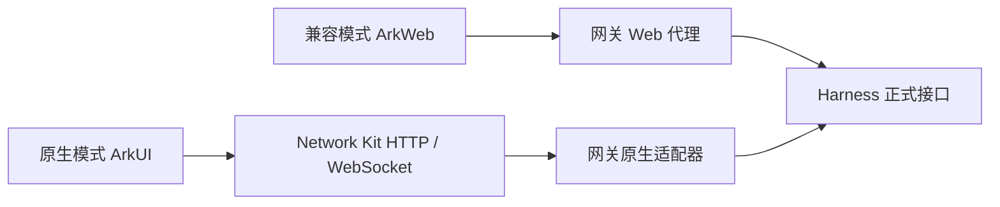

# 兼容模式与原生模式

DSH Harmony 提供两套界面，连接同一工作空间、沿用同一登录会话。首次使用默认进入兼容模式；可通过顶部“兼容 / 原生”按钮、应用设置中的界面模式选项切换。选择仅保存在当前设备，不改变服务端认证策略。

## 选择模式

| 模式 | 渲染方式 | 适用场景 |
| --- | --- | --- |
| **兼容模式** | ArkWeb 加载 Harness 原版界面 | 完整功能、插件专用面板、附件、审批和复杂交互 |
| **原生模式（实验）** | ArkUI 渲染会话和应用设置，通过 Network Kit 连接网关 | 原生列表、输入、文本与代码展示，探索系统动效和流畅性优化 |

原生模式没有通过隐藏网页或解析 DOM 来模拟聊天界面。会话列表、消息列表、输入框、代码块、工具详情、设置和模式选择使用鸿蒙组件。**Passkey 注册与登录仍临时使用共用的 ArkWeb 认证页面**；认证完成后返回原生界面。这是认证流程边界，不代表所有 Web 功能已经原生化。

切换会重建当前渲染界面。切换前应保存兼容模式中尚未发送的草稿。原生草稿只保存在当前进程内存中，切换模式时可恢复，退出连接或结束进程后不保留。

## 功能范围

| 功能 | 兼容模式 | 原生模式 |
| --- | --- | --- |
| 会话列表、新建会话 | Harness 原版 | 原生列表与空状态；新建使用服务端默认工作目录和 Preset |
| 历史记录 | Harness 原版 | 原生分页列表，支持消息替换与回放去重 |
| 文本发送、停止执行 | 支持 | 调用正式 Harness 会话接口，不直接请求模型 API |
| 流式文本和思考过程 | Harness 原版 | WebSocket 驱动原生文本，思考过程可展开 |
| 基础富文本 | Harness 原版 | 段落、标题、列表、引用和围栏代码块；复杂 Markdown 保留文本或使用兼容模式 |
| 工具调用与结果 | 插件定义的完整界面 | 原生文本卡片与可折叠执行详情 |
| 审批与提问 | 原版交互 | 显示等待状态，提供切换兼容模式入口；不代替用户提交答案 |
| 图片、附件上传、终端、插件面板 | 原版能力 | 提示使用兼容模式 |
| 模型、项目与插件配置 | Harness 原版 | 使用服务端当前配置，需要调整时切换兼容模式 |
| 应用设置 | Harness 风格的 Web 设置 | 原生设置、浅深/系统主题、减少透明/动效、通知和卡片开关 |
| 通知与桌面卡片 | 支持 | 共用注册及匿名快照机制 |

原生列表最多显示 200 个会话。实时窗口保留最近 400 条可见记录，手动加载历史最多保留 1000 条。单次文本发送限制为 3000 字符；单条展示文本有限长保护，大内容会提示使用兼容模式查看完整版本。

## 渲染和动画

原生模式延续 Harness 的中性色、12–16vp 控件圆角、文本层级和布局。窄屏在会话列表与对话间切换，宽屏显示侧栏和对话。原生消息使用 List / LazyForEach，只为可见区域建立消息组件，追加记录采用增量列表通知。

流式更新以约 40ms 合并刷新，消息文本不会逐 token 触发整个界面重建；阅读历史时不强制滚动到底。面板切换、思考和工具详情展开使用短过渡，并遵循系统及应用减少动态效果设置。原生模式采用键盘缩放避让，文本行高使用可缩放字体单位。

这些实现为后续动画设计和流畅性优化提供基础，**没有经过设备帧率、延迟、功耗或内存基准测试，不宣称已经获得量化性能提升**。

## 数据通路与认证

原生适配器位于 `gateway/src/native-harness.mjs`，只转接固定的 session/list、create、page、prompt、cancel，以及 follow、observeState。上游协议依据 NOTICE 记录的源码版本，包括严格的 RPC 参数名和 Remote mux 帧；没有新增通用任意 RPC 入口。

应用通过 WebCookieManager 读取自身网关的登录 cookie，Native Network Kit 只将该 cookie 发送给配置的 HTTPS 源，禁止 HTTP 重定向。上游 Harness 的启动令牌和认证 cookie 继续由服务器持有，原生客户端和桌面卡片不会取得它们。临时登录页使用相同 cookie 存储，两种模式不需要分别配对。

实时接口为 `/pocket/native/live`。网关检查 Host、Origin 和登录会话，绑定指定会话，限制同时连接数量并设置心跳和快照等待超时。下行通道不接受客户端命令；所有发送和停止操作走独立的已认证 HTTP 入口。退出登录会关闭对应的原生和上游连接。

原生模式不把对话、代码、草稿或工具参数写入新增本地文件；界面模型保留在内存。原有网页存储策略和 Harness 自身的服务端会话持久化保持各自原有行为。

## 断线和不确定结果

重连只恢复读取：获取新的历史与在途流基线，按会话事件序号及流索引避免重复。流缺帧时重新同步，不拼接可能缺失的内容。退到后台或离开原生视图时释放实时连接，回前台重新读取。

消息发送失败不会自动重发。认证或请求校验的明确拒绝不算已提交；网络中断或上游结果不明时保留草稿，并要求用户刷新核对后明确允许再次发送。新建会话也不会在网络失败时自动重复执行。

## 部署和验证

更新网关依赖后重新启动，再构建新版应用。原生聊天不要求安装新的 Harness 插件；现有通知插件仍用于任务提醒和桌面概览。网关需要能够访问当前 Harness 的正式会话 RPC 和 Remote mux 接口。反向代理除现有路径外，还需转发 `/pocket/native/live` 的 WebSocket 升级。

自动化验证包括真实 HTTP / WebSocket 测试上游、RPC 参数、流基线和文本增量、历史替换、注销撤销连接、跨源与命令注入拒绝、cookie 白名单、请求禁止重定向、模式偏好持久化和不确定发送状态。上游测试使用协议夹具，原生服务模型使用 Kit 模拟。

**仍需 DevEco 编译、完整 Harness 联调和 HarmonyOS 真机验收**。建议逐项验证：

1. 默认兼容模式与两种入口切换，重新启动后保留选择；升级旧安装时保持原有登录。
2. 原生模式首次登录、Passkey 取消与成功返回，登录过期后重新认证；无验证模式下的通知管理 cookie。
3. 两种模式查看同一实际会话，新建、发送、流式回复、停止、历史分页、工具和思考详情；确认没有重复发送。
4. 审批、提问、图片及插件界面的兼容模式引导；原生新建会话的默认目录和模型符合部署预期。
5. 切后台、断网、服务端重启、流缺帧、模式切换期间的草稿与连接释放，退出后全部实时连接撤销。
6. 手机、平板、分屏和折叠屏，大字体、浅深主题、键盘、读屏及减少动效；检查原生列表滚动位置和长代码展示。
7. 用实际设备测量帧率、输入延迟、内存与耗电，再决定是否扩大原生模式覆盖范围。
